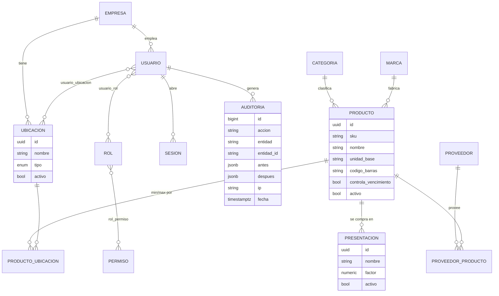
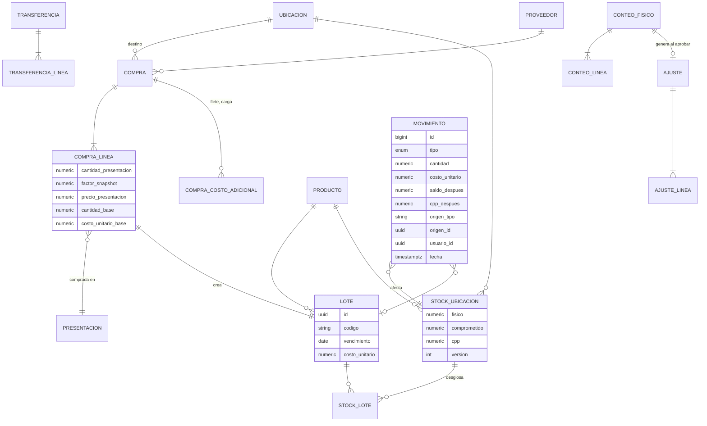
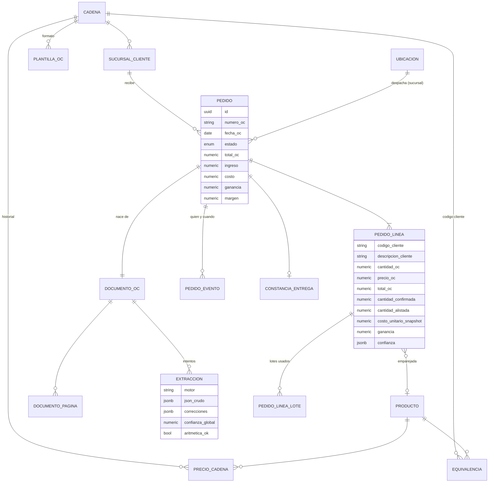

# Arquitectura

Especificación: [`PROMPT_sistema_inventario.md`](../PROMPT_sistema_inventario.md) ·
Decisiones del cliente: [`decisiones-negocio.md`](decisiones-negocio.md) ·
ADRs: [`adr/`](adr/)

## Visión general

```
 Celulares / PC  ──HTTP(S)──►  Caddy (web)
                                 ├── /          → frontend estático (React PWA)
                                 └── /api/*     → backend (FastAPI)
                                                    ├── PostgreSQL (datos, auditoría)
                                                    └── Redis ◄── worker (Celery: OCR, alertas, ML)
```

**Monolito modular**: un solo despliegue, dividido en módulos de dominio con límites claros.

```
backend/app/
├── core/            configuración, BD, seguridad, errores, logs, esquemas comunes
├── modules/
│   ├── identidad/     usuarios, roles, permisos, sesiones, auditoría        ✅ Fase 0
│   ├── organizacion/  empresa, ubicaciones (depósito/sucursal)              ✅ Fase 0
│   ├── catalogo/      categorías, marcas, productos, presentaciones         Fase 1
│   ├── proveedores/   proveedores, historial de precios de compra           Fase 1
│   ├── clientes/      cadenas, sucursales de supermercado, precios, equivalencias  Fase 1
│   ├── compras/       compras, costos prorrateados, lotes                   Fase 1
│   ├── inventario/    libro de movimientos, saldos, CPP, reservas, kardex   Fase 1
│   ├── pedidos/       OC → pedido, estados, rentabilidad                    Fase 2a
│   ├── documentos/    archivos, extractores, plantillas por cadena          Fase 2b
│   ├── reportes/      consultas de solo lectura, exportación                Fase 3
│   ├── alertas/       reglas y notificaciones                               Fase 4
│   └── ml/            pronóstico, reposición, anomalías                     Fase 4
└── workers/         tareas Celery
```

Cada módulo sigue la misma forma:

| Archivo | Responsabilidad |
|---|---|
| `models.py` | Tablas (SQLAlchemy) |
| `schemas.py` | Entrada/salida de la API (Pydantic) |
| `servicios.py` | Casos de uso: validan, modifican, auditan y hacen `commit` (una transacción por caso de uso) |
| `api.py` | Rutas delgadas: permisos + llamada al servicio |
| `dominio.py` | Lógica pura sin BD (conversiones, CPP, rentabilidad), cuando exista |

## Principios

1. **El stock solo cambia a través de `InventarioService`** (Fase 1), que en una transacción
   bloquea el saldo (`SELECT … FOR UPDATE`), valida, escribe el movimiento, actualiza saldo/CPP/lote
   y audita.
2. **Libro de movimientos inmutable.** Nada se edita ni se borra: se anula con un movimiento de
   reverso y motivo. Un proceso de verificación recalcula el stock desde el libro.
3. **Bitácora de auditoría inmutable**, protegida por un trigger de PostgreSQL (ni la aplicación
   puede modificarla). Guarda usuario, acción, entidad, antes/después, IP y fecha.
4. **Permisos granulares.** Los permisos se definen en código
   (`app/modules/identidad/permisos.py`); los roles se arman en la base de datos. El Dueño siempre
   tiene todos.
5. **Multiempresa desde el inicio:** las tablas de negocio llevan `empresa_id`.
6. **Tipos exactos:** dinero `NUMERIC(14,2)`, costo unitario `NUMERIC(18,6)`, cantidades
   `NUMERIC(14,3)` en unidad base, fechas `timestamptz` (zona America/La_Paz en la interfaz).
7. **Eventos de dominio** (`CompraRegistrada`, `PedidoAlistado`…) en una tabla *outbox* para que
   alertas, ML y finanzas se suscriban sin acoplarse (desde la Fase 1).
8. **Mensajes al usuario en español**, nunca trazas técnicas. Logs estructurados en JSON.

## Seguridad (Fase 0)

- Contraseñas con Argon2. Verificación con tiempo constante también para correos inexistentes.
- Sesión en cookie `httpOnly` + `SameSite=Lax` (`Secure` con HTTPS). Solo se guarda el hash del
  token en la base.
- CSRF: token por sesión, enviado en la cabecera `X-CSRF-Token` en toda petición que modifica datos.
- Bloqueo tras 5 intentos fallidos por correo (o 20 por IP) en 15 minutos.
- Desactivar un usuario o restablecer su contraseña cierra todas sus sesiones.
- Siempre queda al menos un Dueño activo.
- Caddy añade cabeceras de seguridad y limita el tamaño de las subidas.

## Modelo de datos

Implementado en la Fase 0: `empresa`, `ubicacion`, `usuario`, `rol`, `permiso`, `rol_permiso`,
`usuario_rol`, `usuario_ubicacion`, `sesion`, `intento_login`, `auditoria`.

Diagrama previsto (las fases siguientes pueden ajustarlo):

### Identidad, organización y catálogo



### Compras e inventario



- Las transferencias son inmediatas (D-13): generan `TRANSFERENCIA_SALIDA` y `TRANSFERENCIA_ENTRADA`
  en la misma transacción.
- Cada compra crea un lote interno para todos los productos. En los que no controlan vencimiento
  los lotes se asignan solos (FIFO) y no aparecen en la interfaz; así queda lista la valoración PEPS.

### Clientes, OC y pedidos



- `UNIQUE(empresa_id, cadena_id, numero_oc)` sobre pedidos no anulados (OC duplicadas).
- Cantidades y precios de la OC siempre por unidad base (D-10).
- `cantidad_confirmada ≤ disponible` al confirmar (D-02); `cantidad_alistada ≤ confirmada` (D-11).

## Plan por fases

| Fase | Contenido | Estado |
|---|---|---|
| 0 · Base | Monorepo, Docker Compose, BD, autenticación, roles/permisos, ubicaciones, auditoría, CI, PWA base, respaldos | ✅ |
| 1 · Inventario | Catálogo, presentaciones, proveedores, cadenas y sucursales de supermercado, compras con prorrateo, lotes, CPP por ubicación, transferencias, ajustes, conteos, kardex, stock físico/comprometido/disponible | Pendiente |
| 2a · Pedidos | OC adjunta (foto/PDF) con carga manual, revisión, validación aritmética, equivalencias, reserva, alistado con FEFO, rentabilidad, entrega con constancia, anulación, duplicados, PWA con cámara y cola de subida | Pendiente |
| 2b · Lectura automática | PDF con texto, OCR de fotos, plantillas por cadena, confianza, emparejamiento automático, métricas de precisión | Pendiente (requiere OC reales) |
| 3 · Reportes | Dashboard y métricas, exportación Excel/PDF | Pendiente |
| 4 · Alertas y ML | Alertas, pronóstico, reposición en dos niveles, anomalías | Pendiente |
| 5 · Finanzas | Cuentas por cobrar/pagar, gastos, contabilidad, impuestos | Futuro |
